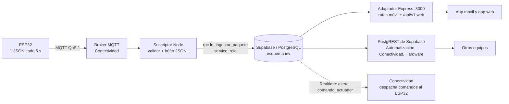

# Backend y base de datos · Invernadero de albahaca

Equipo **Base de datos y Backend**. Invernadero inteligente de albahaca de 1.00 × 0.60 m. Este directorio contiene la base de datos (esquema `inv` de PostgreSQL/Supabase), el suscriptor MQTT, el adaptador REST que consumen las apps y los scripts de operación.

> **Estado (22 nov 2026).** Todavía **no** se ha conectado a un proyecto Supabase. Lo probado hasta hoy es el SQL en un PostgreSQL 18 temporal, la restauración local del respaldo y las pruebas unitarias (`npm test`). Todo lo que necesita Supabase, el broker o el ESP32 está marcado como PENDIENTE en [`docs/casos_prueba.md`](docs/casos_prueba.md).

## Qué hay aquí

```
backend/
├── bd/
│   ├── invernadero_bd.sql        Esquema inv: 18 tablas, 6 vistas, funciones, triggers y datos iniciales
│   ├── supabase.sql              Permisos por rol, RLS, trigger de perfiles, Realtime y purga con pg_cron
│   └── pruebas/                  stub_supabase.sql (solo local) y pruebas SQL (restricciones, ingesta, RLS)
├── src/
│   ├── suscriptor.js, ingesta.js, buffer.js   MQTT -> validación -> fn_ingestar_paquete, con búfer sin conexión
│   ├── supabase.js               Carga .env y crea los clientes de Supabase (esquema inv)
│   ├── index.js                  Arranca suscriptor y API en un solo proceso
│   └── api/                      Adaptador Express (puerto 3000): rutas de la app móvil y /api/v1 de la web
├── scripts/                      broker, simular, usuarios, respaldo, psql, diccionario
├── test/                         Pruebas unitarias (node --test), sin red ni base de datos
├── docs/                         Documentación (ver abajo)
├── .env.example                  Variables de entorno (copiar a .env; .env nunca se sube)
└── package.json
```

## Flujo de datos



El adaptador Express es la única pieza fuera del plan original ("sin Express salvo que haga falta"): las apps del repo piden rutas en español y un sobre `/api/v1` que PostgREST no ofrece. Está justificado en [`docs/control_cambios.md`](docs/control_cambios.md).

## Requisitos

- **Node.js 22 o superior** (`engines` en `package.json`; el `.env` se carga con `process.loadEnvFile`).
- **Herramientas cliente de PostgreSQL 18** (`psql`, `pg_dump`). Se buscan en la carpeta `PG_BIN` del `.env` (en Windows, `C:\Program Files\PostgreSQL\18\bin`); si no están ahí se busca `psql` en el `PATH`.
- Un **PostgreSQL local** (solo para `npm run test:bd` y la restauración del respaldo), con un usuario que pueda crear bases de datos.
- Un proyecto **Supabase Free** (500 MB, se pausa tras 1 semana sin uso, sin respaldos automáticos).
- Un broker MQTT: el de Conectividad, o el broker local de simulación (`npm run broker`).

## Puesta en marcha

Todos los comandos se corren desde `backend/`.

1. **Crear el proyecto Supabase** (plan Free) y anotar, en *Project Settings → API*, la URL del proyecto, la llave `anon` (o *publishable*) y la `service_role` (o *secret*). En *Connect* copiar la cadena **Session pooler** (lleva la contraseña de la BD).
2. **Configurar el entorno.**
   ```
   copy .env.example .env      (en bash: cp .env.example .env)
   npm install
   ```
   Llenar en `.env`: `SUPABASE_URL`, `SUPABASE_ANON_KEY`, `SUPABASE_SERVICE_ROLE_KEY`, `SUPABASE_DB_URL`, `MQTT_URL` (y `MQTT_USERNAME`/`MQTT_PASSWORD` si el broker los pide). Las llaves nunca se suben al repo ni se pegan en chats o documentos.
3. **Instalar el esquema en Supabase** (en este orden; cada archivo se corre con `ON_ERROR_STOP`):
   ```
   node scripts/psql.js --supabase bd/invernadero_bd.sql bd/supabase.sql
   ```
   - `invernadero_bd.sql` **no es re-ejecutable** (crea tablas sin `IF NOT EXISTS`; si falla, su transacción se deshace). Para repetirlo hay que borrar antes el esquema (`DROP SCHEMA inv CASCADE`).
   - `supabase.sql` sí es idempotente: se puede volver a correr, por ejemplo después de agregar tablas o funciones para que reciban sus permisos.
   - `stub_supabase.sql` **nunca** se corre en Supabase; solo en PostgreSQL local.
4. **Exponer el esquema `inv`:** *Settings → API → Exposed schemas* → agregar `inv`. Sin esto PostgREST responde `PGRST106` y el adaptador falla (ver Solución de problemas).
5. **Crear las cuentas de equipo:**
   ```
   npm run usuarios            crea las que falten y corrige su rol (no toca contraseñas existentes)
   npm run usuarios -- --reset regenera todas las contraseñas
   ```
   Crea `eq-app` (OPERADOR), `eq-automatizacion`, `eq-conectividad`, `eq-hardware` y `prueba-lector` (LECTOR), escribe sus correos y contraseñas en `.env` y **no imprime contraseñas**. El adaptador usa la cuenta `eq-app` (`APP_EMAIL`/`APP_PASSWORD`).
6. **Arrancar:**
   ```
   npm run suscriptor    solo el suscriptor MQTT
   npm run api           solo el adaptador REST (escucha en 0.0.0.0:3000, o PORT)
   npm start             los dos en un mismo proceso
   ```
   Con `npm run api` sin `.env`, el servidor arranca y `GET /` responde `{"ok":true}`; las rutas que necesitan Supabase responden **503**. Con `npm start` sin `.env` el proceso termina de inmediato con "Falta SUPABASE_URL" (el suscriptor se importa primero).
7. **Apuntar las apps al adaptador:**
   - App móvil: `EXPO_PUBLIC_API_URL=http://<IP de la laptop>:3000` (sin `/` al final y sin `/api`) y reiniciar Expo con `expo start -c`.
   - App web: usa el prefijo `/api/v1` del mismo servidor.

Las rutas están en [`docs/API.md`](docs/API.md).

## Simulación sin hardware

Tres terminales (con `.env` ya configurado):

```
npm run broker                      # terminal 1: broker local (aedes) en el puerto de MQTT_URL (por omisión 1883)
npm run suscriptor                  # terminal 2 (o npm start)
npm run simular -- --validos 12 --invalidos --intervalo 1000    # terminal 3
```

Flags de `scripts/simular.js`:

| Flag | Por omisión | Efecto |
|---|---|---|
| `--validos N` | `12` | Publica N mensajes con el formato exacto del firmware. El mensaje *i* trae humedad de suelo 1 = 40 + *i* % y temperatura ambiente = 20 + *i*/10 °C (valores conocidos para verificar). |
| `--invalidos` | desactivado | Agrega 3 mensajes: texto que no es JSON, un JSON sin `sensores` y un JSON con el DS18B20 desconectado (-127). |
| `--intervalo ms` | `1000` | Pausa entre mensajes. |
| `--nodo codigo` | `invernadero_albahaca_01` | `nodo_id` de los mensajes. |

El procedimiento completo con salidas esperadas está en [`docs/recorrido_e2e.md`](docs/recorrido_e2e.md).

## Pruebas

| Comando | Qué corre | Requiere |
|---|---|---|
| `npm test` | 38 pruebas unitarias: ingesta (validar, búfer, broker aedes en memoria), rutas móvil y `/api/v1`, formato, `sinClave` | Solo Node |
| `npm run test:bd` | Crea la BD `invernadero_test` en el PostgreSQL local y corre, en orden: `stub_supabase.sql`, `invernadero_bd.sql`, `supabase.sql`, `pruebas_restricciones.sql`, `pruebas_ingesta.sql`, `pruebas_rls.sql`. Imprime PASS/FAIL por archivo. | `LOCAL_DB_URL` y `PG_BIN` en `.env` |
| `npm run diccionario` | Regenera `docs/diccionario_datos.md` desde los `COMMENT` del esquema; falla si una tabla o columna no tiene comentario | Haber corrido `npm run test:bd` antes |

`LOCAL_DB_URL` apunta al servidor local (ejemplo en `.env.example`); `test:bd` **borra y recrea** `invernadero_test`.

## Respaldo y restauración

```
npm run respaldo                    # origen: Supabase (SUPABASE_DB_URL)
npm run respaldo -- --origen local  # origen: la BD invernadero_test (tras npm run test:bd)
```

El script: (1) hace `pg_dump -n inv` a `backups/inv_AAAAMMDD_HHMM.sql`; (2) recrea la BD local `invernadero_restore`; (3) carga `stub_supabase.sql` y el volcado; (4) compara el número de filas de cada tabla entre origen y restauración y sale con código 1 si alguna difiere. `backups/` no se sube al repo: **copiar el archivo generado al Google Drive del equipo** (Supabase Free no tiene respaldos automáticos). La contraseña viaja en `PGPASSWORD`, nunca en los argumentos.

## Operación

- **Espacio (500 MB del plan Free).** A 5 s por paquete el esquema crece unos 20–40 MB por día de sesión (estimación del análisis, ver `docs/inconsistencias.md` §5). Medirlo cada semana en el *SQL Editor* de Supabase:
  ```sql
  SELECT pg_size_pretty(pg_database_size(current_database()));
  SELECT relname, pg_size_pretty(pg_total_relation_size(oid)) FROM pg_class
   WHERE relnamespace = 'inv'::regnamespace AND relkind = 'r' ORDER BY pg_total_relation_size(oid) DESC;
  ```
  **Umbral de 80 % = 400 MB:** si se rebasa, aplicar las medidas del plan: confirmar que la purga corre, guardar promedios por minuto en vez de cada lectura y, como último recurso, contratar 1 mes de Supabase Pro (reserva de $470 MXN).
- **Purga de 7 días.** `supabase.sql` programa con `pg_cron` el trabajo `purgar-payload-inv` (`0 9 * * *`, es decir 03:00 en America/Mexico_City) que ejecuta `SELECT inv.fn_purgar_payload(7)`: pone en `NULL` el JSON crudo (`inv.paquete.payload`) de paquetes con más de 7 días; las mediciones se conservan. Si `pg_cron` no está disponible, `supabase.sql` avisa con un NOTICE y la purga se corre a mano con esa misma sentencia.
- **Pausa del plan Free.** Supabase pausa el proyecto tras 1 semana sin uso; hay que reactivarlo desde el panel antes de una sesión.
- **Durante una sesión.** El suscriptor corre en la laptop de un integrante. Si se cae el internet guarda en `buffer/pendientes.jsonl` y reenvía al volver (ver [`docs/contrato_mqtt.md`](docs/contrato_mqtt.md)).
- **Seguridad.** El adaptador acepta peticiones sin `Authorization` (actúa la cuenta `eq-app`), con CORS abierto y escuchando en 0.0.0.0: cualquiera en la red puede mandar comandos. Es un riesgo conocido pendiente de decisión (`docs/inconsistencias.md` §6.1).

## Solución de problemas

| Síntoma | Causa y solución |
|---|---|
| El adaptador responde 500 "Error interno" y el log dice `PGRST106` | El esquema `inv` no está expuesto. *Settings → API → Exposed schemas* → agregar `inv`. |
| Las rutas de datos responden **503** "Backend sin configurar o cuenta de equipo no disponible" | Falta una variable del `.env` (`SUPABASE_URL`, `SUPABASE_ANON_KEY`, `APP_EMAIL`, `APP_PASSWORD`) o la cuenta `eq-app` no existe/no puede iniciar sesión. Correr `npm run usuarios`. |
| 503 "Supabase no disponible" | La laptop no llega a Supabase (red, proyecto pausado). Reactivar el proyecto o revisar la conexión. |
| La app móvil no conecta o da 404 | `EXPO_PUBLIC_API_URL` debe ser `http://IP:3000`, **sin `/` al final y sin `/api`** (la app concatena la ruta tal cual); reiniciar con `expo start -c`. Un APK/IPA de release bloquea `http://` hacia una IP local; con Expo Go funciona. |
| La app no alcanza la laptop | Firewall de Windows: permitir Node.js en el puerto 3000 de la red privada. La IP de la laptop cambia entre redes; revisar con `ipconfig` y que teléfono y laptop estén en la misma red. |
| `npm start` termina con "Falta SUPABASE_URL ..." | No hay `.env` (o falta esa variable). Copiar `.env.example` a `.env` y llenarlo. |
| El suscriptor imprime `SIN CONEXION → búfer` | No llega a Supabase. Los mensajes quedan en `buffer/pendientes.jsonl` y se reenvían cada 15 s y al reconectar el broker. |
| `npm run test:bd` falla al crear la BD | Revisar `LOCAL_DB_URL` (servidor, usuario, contraseña) y que el servicio de PostgreSQL local esté activo. |
| `psql` no se encuentra | Ajustar `PG_BIN` en `.env` o poner la carpeta `bin` de PostgreSQL en el `PATH`. |

## Documentación

| Documento | Contenido |
|---|---|
| [`docs/API.md`](docs/API.md) | Adaptador REST (rutas móvil y `/api/v1`) y PostgREST directo, permisos por rol, errores, Realtime, códigos de dispositivo |
| [`docs/contrato_mqtt.md`](docs/contrato_mqtt.md) | Topics, JSON aceptado, validación, búfer sin conexión, estados del firmware, flujo de comandos |
| [`docs/modelo_er.md`](docs/modelo_er.md) | Diagrama entidad-relación, equivalencias con E1 y semántica de datos ausentes |
| [`docs/diccionario_datos.md`](docs/diccionario_datos.md) | Diccionario de datos generado (no editar a mano) |
| [`docs/control_cambios.md`](docs/control_cambios.md) | Cambios al modelo congelado en H2 y decisiones técnicas |
| [`docs/casos_prueba.md`](docs/casos_prueba.md) | Casos de prueba con resultados esperados y obtenidos |
| [`docs/recorrido_e2e.md`](docs/recorrido_e2e.md) | Recorrido MQTT → BD → API (pendiente de ejecutar) |
| [`docs/inconsistencias.md`](docs/inconsistencias.md) | Análisis del repositorio, contradicciones y pendientes por equipo |
| [`docs/postman/`](docs/postman/invernadero.postman_collection.json) | Colección Postman v2.1 |
