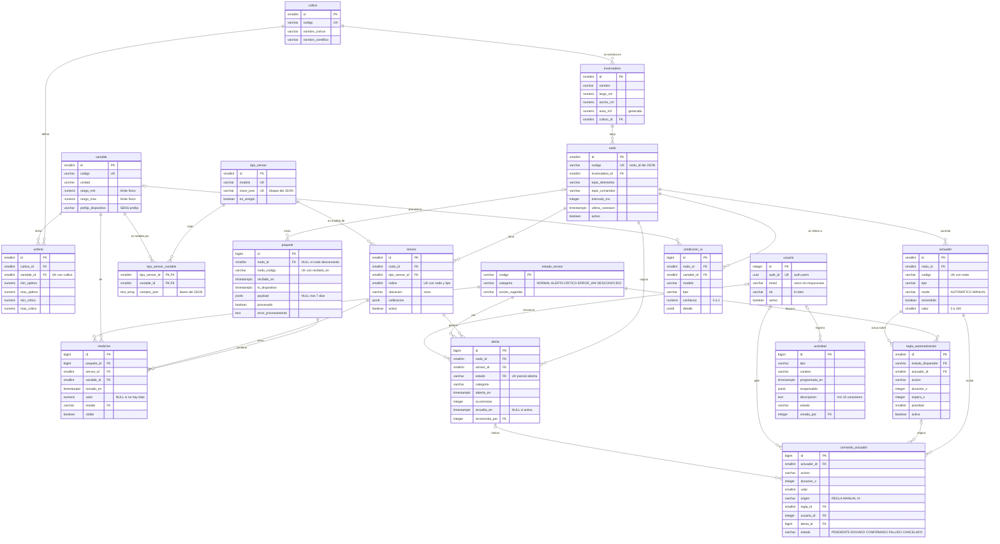

# Modelo entidad-relación y modelo relacional

Esquema `inv` de PostgreSQL (`bd/invernadero_bd.sql`): **18 tablas** y **6 vistas**. El detalle de cada columna (tipo, nulabilidad, clave, descripción) está en el [diccionario de datos](diccionario_datos.md), generado desde los `COMMENT` del esquema; aquí solo van las claves y las columnas que explican el modelo.

## Diagrama

## Notas del modelo relacional

- **Normalización.** Las magnitudes, los modelos de sensor y los estados son catálogos (`variable`, `tipo_sensor`, `estado_sensor`); `tipo_sensor_variable` resuelve la relación N:M entre modelos y magnitudes (un DHT22 mide dos variables; un HC-SR04, dos). Una lectura es una fila de `medicion` por sensor y variable (~9 por paquete, unas 155 mil al día a 5 s).
- **Guiado por datos.** La ingesta no tiene sensores escritos en código: lee `tipo_sensor.clave_json`, `es_arreglo` y `tipo_sensor_variable.campos_json`. Un sensor nuevo es un `INSERT`, no un cambio de función.
- **Claves.** Casi todas son `GENERATED ALWAYS AS IDENTITY`; la excepción es `estado_sensor`, cuya clave natural es el `codigo` que manda el firmware. Los códigos de negocio (`nodo.codigo`, `cultivo.codigo`, `variable.codigo`) son `UNIQUE` y se usan para empatar con el JSON.
- **Unicidades relevantes.** `(nodo_codigo, recibido_en)` en `paquete` (idempotencia); `(paquete_id, sensor_id, variable_id)` en `medicion`; `(nodo_id, tipo_sensor_id, indice)` en `sensor`; `(cultivo_id, variable_id)` en `umbral`; índice único parcial `(sensor_id, estado) WHERE resuelta_en IS NULL` en `alerta` (una alerta abierta por sensor y estado); `lower(email)` en `usuario`.
- **Integridad por reglas.** `CHECK` de rangos (`valor` 0–100, `confianza` 0–1, `duracion_s > 0`), de enumeraciones (`rol`, `origen`, `estado`, `tipo`, `categoria`) y compuestos: `origen = 'MANUAL'` exige `usuario_id` y `origen = 'REGLA'` exige `regla_id`; `min_optimo <= max_optimo`. Se comprueban en `bd/pruebas/pruebas_restricciones.sql`.
- **`usuario.auth_id`** liga el perfil con `auth.users` de Supabase Auth **sin llave foránea**, para que un respaldo de `inv` se restaure en cualquier PostgreSQL. No hay contraseñas en `inv`.
- **`paquete.payload`** es el JSON crudo y se pone en `NULL` a los 7 días; `medicion` conserva lo importante. `medicion.paquete_id` borra en cascada, pero el esquema no concede `DELETE` a ningún rol de la app.
- **Vistas** (nombres de columna son contrato con el adaptador REST): `v_ultima_medicion` (último valor por sensor activo × variable, con evaluación contra umbrales y tendencia), `v_lectura` (histórico en formato largo), `v_alertas_activas`, `v_estado_nodo`, `v_bitacora` (telemetría + comandos + alertas) y `v_dataset_ia` (1 fila por paquete, solo lecturas válidas). Todas son `security_invoker`.
- **Tiempo.** Todo es `timestamptz` (UTC); se convierte a America/Mexico_City al consultar.

## Equivalencias con las entidades de E1

| Entidad de E1 | En el modelo implementado |
|---|---|
| Cultivo | `cultivo` |
| Umbral | `umbral` (por cultivo y variable: óptimo y crítico) |
| Zona | No hay tabla de zonas. Es `sensor.ubicacion` (`Zona 1`..`Zona 3` en los capacitivos); para las apps, `zone_id` = id del invernadero (`invernadero`). |
| Dispositivo | `sensor` y `nodo`. El código de dispositivo de las apps (`SENS-…`) se calcula con `fn_codigo_dispositivo` y aparece como `codigo` en `v_ultima_medicion` y `v_lectura`. |
| Magnitud | `variable` (con unidad y rango físico) y `tipo_sensor_variable` |
| Sensor | `sensor` (instalación) + `tipo_sensor` (modelo) |
| Lectura | `medicion` (y `paquete` como mensaje crudo); consulta cómoda: `v_lectura` |
| Lectura actual | `v_ultima_medicion` |
| Alerta | `alerta` (y `v_alertas_activas`) |
| Actuador | `actuador` |
| Comando | `comando_actuador` |
| Usuario | `usuario` (perfil de Supabase Auth) |
| Grupo | No hay tabla. Los grupos de permisos son los seis valores de `usuario.rol` (ADMIN, OPERADOR, LECTOR, AUTOMATIZACION, CONECTIVIDAD, HARDWARE); sus permisos están en `bd/supabase.sql`. *(Interpretación del equipo; confirmar si E1 pedía otra cosa.)* |

Tablas sin entidad en la lista de E1: `invernadero`, `nodo`, `estado_sensor`, `regla_automatizacion`, `prediccion_ia`, `actividad`, `paquete`.

## Semántica de dato ausente

Nunca se inventa un número. Cuatro situaciones distintas:

| Situación | Cómo se representa | Qué ve el cliente |
|---|---|---|
| El mensaje no trae el valor, o no es numérico | `medicion.valor = NULL`, `valido = false` | `valor` null; el sensor no aparece como vigente |
| El sensor reporta falla (`ERROR_HW`) o el valor cae fuera del rango físico | `valor` con lo recibido (p. ej. -127), `valido = false`, estado `ERROR_*` o `LECTURA_FUERA_DE_RANGO` | `v_ultima_medicion.evaluacion = SIN_DATO_VALIDO`; excluida de histórico, estadística y dataset de IA |
| El sensor está dado de alta pero nunca ha mandado nada | No hay fila en `medicion` (la vista usa `LEFT JOIN`) | `evaluacion = SIN_LECTURA`, `valor`/`tomado_en` null |
| El sensor no existe (EC, CO₂) | Sin sensor ni variable | El adaptador manda `null` (`ec_ms_cm`, `co2_ppm`) |

- **`valido`** es la bandera que todo consumidor debe respetar: `false` = no usar en gráficas, promedios ni IA.
- **Vigencia en el adaptador:** además de `valido = true`, una lectura debe tener ≤ 10 minutos para considerarse "actual"; si no, se muestra `--` y el sensor aparece sin conexión. Un sensor caído nunca se promedia como 0.
- **Evaluación contra umbrales** (`v_ultima_medicion.evaluacion`): `CRITICO` (≤ `min_critico` o ≥ `max_critico`), `FUERA_DE_OPTIMO` (fuera de `min_optimo`..`max_optimo`), `OPTIMO`, `SIN_UMBRAL` (la variable no tiene fila en `umbral`).

## Umbrales configurables

Los umbrales son **datos**, no código: viven en `inv.umbral`, uno por cultivo y variable, y se pueden cambiar en cualquier momento (desde la app móvil con `PUT /umbrales/:sensorId`, o por PostgREST con `PATCH umbral`; roles OPERADOR, AUTOMATIZACION o ADMIN). Cada límite puede ser `NULL` (sin límite en ese sentido).

Los iniciales salen del firmware v1.0:

| Variable | Óptimo | Crítico |
|---|---|---|
| humedad_suelo | 35 – 75 % | — |
| temperatura_suelo | 15 – 28 °C | — |
| iluminancia | 2 000 – 15 000 lx | — |
| nivel_tanque | — | ≤ 15 % |
| temperatura_aire, humedad_aire, distancia_agua | **sin umbral** (Automatización debe definirlos) | — |

Los estados del firmware (`RIEGO_NECESARIO`, etc.) llevan sus cortes dentro del propio firmware; `umbral` es lo que usan la app, la automatización y la IA para evaluar y mostrar.
